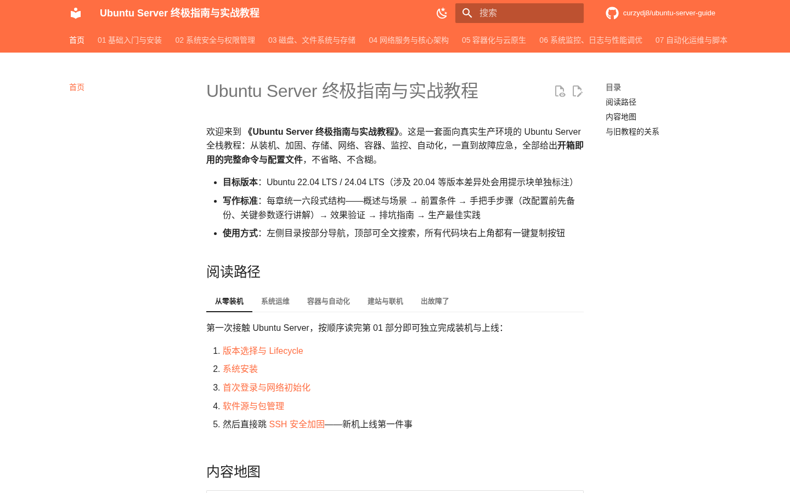

# Ubuntu Server 终极指南与实战教程

[](https://github.com/curzydj8/ubuntu-server-guide/actions/workflows/ci.yml)
[](https://curzydj8.github.io/ubuntu-server-guide/)
[](https://ubuntu.com/server)
[](LICENSE)

全面、深度的 Ubuntu Server 全栈教程站：13 个部分、54 章正文，从装机、安全、存储、网络、容器、监控、自动化、故障排查，一直到网站部署、游戏服务器、数据库高可用、GPU 虚拟化与 AI 运维，全部按统一六段式模板撰写，命令开箱即用。

**在线阅读**：https://curzydj8.github.io/ubuntu-server-guide/



## 内容地图

| 部分 | 主题 |
| --- | --- |
| 01 | 基础入门与安装（版本选择、安装、Netplan、包管理） |
| 02 | 系统安全与权限管理（SSH 加固、Sudo/PAM、防火墙、入侵防御） |
| 03 | 磁盘、文件系统与存储（LVM、ZFS/Btrfs、挂载共享、备份） |
| 04 | 网络服务与核心架构（DNS、Web 反代、VPN、时间与日志） |
| 05 | 容器化与云原生（Docker、Podman、轻量 K8s） |
| 06 | 系统监控、日志与性能调优（Prometheus/Grafana、日志栈、内核调优） |
| 07 | 自动化运维与脚本（Shell、Systemd、Ansible） |
| 08 | 故障排查与应急响应（启动修复、网络排查、磁盘爆满、性能定位） |
| 09 | 网站搭建、域名与应用部署（解析、宝塔、LNMP、容器应用、HTTPS 证书） |
| 10 | 游戏服务器部署与端口映射（三重门、Minecraft/Palworld、守护调优、内网穿透） |
| 11 | 数据库安装、管理与高可用（MySQL、PostgreSQL、Redis、MongoDB、主从复制） |
| 12 | 硬件、虚拟化与私有云（GPU/CUDA、KVM/PVE、PCIe 直通） |
| 13 | AI 工具与智能化运维（Ollama、AI CLI、IaC/GitOps） |

另有**互动工具页**（Netplan / UFW 配置生成器）和一键脚本（`docs/scripts/`）。

## 目录结构

```text
.
├── mkdocs.yml            # 站点配置与导航（Material 主题）
├── docs/                 # 全部章节 Markdown 源文件（按部分分目录）
│   ├── scripts/          # 一键脚本（init-server.sh / install-docker.sh）
│   └── assets/           # 站点级静态资源（OG 分享图等）
├── overrides/            # 主题模板覆盖（Open Graph 标签注入）
├── assets/               # 仓库级图片（README 截图）
├── .github/workflows/    # CI：构建校验 / 死链扫描 / 脚本冒烟 / 格式校验
└── site/                 # 构建产物（发布到 gh-pages 分支，不纳入 main）
```

## 本地构建

```bash
pip install mkdocs-material jieba
mkdocs serve   # 本地预览 http://127.0.0.1:8000
mkdocs build   # 构建到 site/
```

## 参与贡献

- **改错字、修命令**：每篇教程页右上角有「编辑此页」按钮，跳转到对应源文件，改完提 Pull Request 即可。
- **命令报错**：请用 Issue 模板「教程命令报错反馈」，附上 Ubuntu 版本与完整报错输出。
- **想要新章节**：请用 Issue 模板「新章节需求」，写清主题、场景与期望深度。

## 维护约定

- CI 每周自动跑死链扫描（lychee，仅报告不拦截），防止软件源与外链过期。
- Markdown 格式由 markdownlint 校验，规则见根目录 `.markdownlint.json`；已按中文技术文档实际放宽：行长（MD013）、内嵌 HTML（MD033，互动工具页需要）、裸 URL（MD034）、模板化小节与代码块风格（MD036/MD040/MD046）、CJK 表格对齐（MD060）等。
- `docs/scripts/` 下的脚本在 CI 里跑 `bash -n` + shellcheck 冒烟（Ubuntu 22.04 / 24.04 双矩阵）。

## 姊妹教程

偏桌面与远程控制场景的旧版教程：https://github.com/curzydj8/ubuntu-server-tutorial

## License

[MIT](LICENSE)
