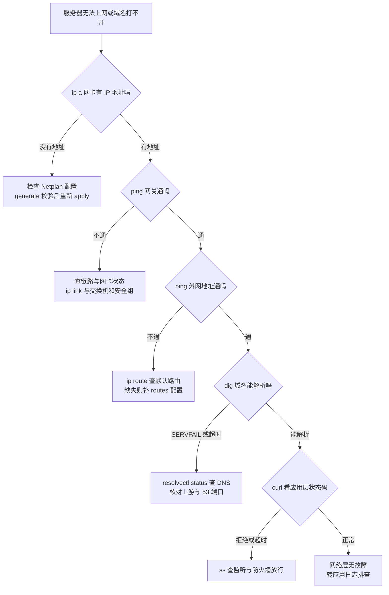

# 网络不通、高延时与丢包排查流程

## 一、概述与使用场景

网络故障的表现非常宽泛：整机连不上、某个服务端口不通、域名解析失败、访问时快时慢、延时从几毫秒涨到几百毫秒、持续丢包导致远程桌面卡顿与接口超时。初学者最容易犯的错误是跳过基础层直接怀疑应用或防火墙，结果在上层反复改配置，真正的故障点例如网关写错、DNS 指错、监听地址只绑了回环口，却一直未被检查。

本章主体是 7 个分层案例，顺序与网络协议栈自下而上一致：先地址，再路由，再解析，再应用，再区分内外网方向，然后是 VPN 与 IPv6 两个专题。每个案例严格按六步推进：**现象 → 检查命令 → 输出判读 → 根因判断 → 修复命令 → 修复后验证**。上一案未确认通过，不进入下一案；例如地址都没有拿到时，不要去查 DNS 与网站配置。

本章示例统一使用文档专用地址段：服务器地址为 `192.0.2.10`，网关为 `192.0.2.1`，DNS 服务器为 `192.0.2.53`，外部测试目标为 `198.51.100.20`，业务域名使用 `example.com`。实际排查时把这些地址替换为本机真实地址，命令结构不变。网卡名统一用 `enp3s0` 示例，执行前先用 `ip -br link` 确认本机真实网卡名再替换。

延时与丢包类问题贯穿各案的验证环节：完全不通先找断点，时通时断先量化。用连续 `ping` 与 `mtr` 测出丢包率与延时分布，再判断故障在本机、局域网、运营商路径还是对端，避免凭单次超时下结论。

## 二、环境准备与前置条件

开始排查前确认以下条件：

- 具有 sudo 权限的账号，能查看网卡、路由、防火墙与抓包。抓包需要 root 权限，普通账号执行 `tcpdump` 会提示无权限打开网卡。
- 本机已安装常用工具。Ubuntu 22.04 与 24.04 默认带有 `ip`、`ping`、`ss`、`curl` 的基础环境，部分工具需要单独安装：

```bash
sudo apt update
sudo apt install -y iputils-ping mtr-tiny tcpdump dnsutils curl iproute2 ethtool
```

- 准备对照信息：本机应有的 IP 地址、子网掩码、网关、DNS 服务器，来自网络规划或云厂商控制台；没有对照值时，错误配置根本看不出来。
- 准备两个外部参照目标：一个稳定的 IP 地址目标用来排除 DNS 因素，一个域名目标用来验证完整链路。参照目标应事先确认本身可用。
- 记录故障时间范围与影响范围：只有本机不通还是同网段多台不通，只有出方向不通还是入方向也不通，这些信息决定从哪一案开始查。

!!! note "先分清故障方向"

    从故障机向外测是出方向，从正常机器向故障机测是入方向。两个方向的结论经常不同：出方向正常而入方向不通，问题多在防火墙、安全组或对端回程路由，对应本章案例五。排查记录中必须注明每次测试的方向、源地址与目标地址，混在一起的记录事后无法使用。

!!! warning "远程改网络先留退路"

    在 SSH 会话中修改 IP 地址、默认路由或执行 `netplan apply`，可能立即断开当前连接。生产操作先通过云控制台或带外管理口保持第二通道，修改前备份原配置文件，修改后在同一窗口内完成连通性验证。没有第二通道时，安排在有现场支持的时段执行。

### 2.1 决策树与关键命令判读（全章总览）

先按图自上而下定位故障层，再进入对应案例，不要跳步猜测。



决策树与案例的对应关系：节点 B 对应案例一，节点 C 与 D 对应案例二，节点 E 对应案例三，节点 F 对应案例四；决策树默认查的是出方向，入方向与专题问题分别走案例五、案例六、案例七。

5 个关键诊断命令逐行判读，全章各案反复使用，先在这里统一讲清：

1. `ip a`：看网卡与地址。重点看目标网卡状态应为 `state UP` 且带 `LOWER_UP` 标志，`inet 192.0.2.10/24` 一行确认地址与掩码已生效；只有 `127.0.0.1` 说明业务网卡没拿到地址，进案例一。
2. `ip route`：看路由表。必须有一行 `default via 192.0.2.1 dev enp3s0`，没有默认路由就出不了本地网段；再核对直连网段行 `192.0.2.0/24 dev enp3s0` 的网卡名是否正确。
3. `resolvectl status`：看 DNS 归属。重点看业务网卡段落下的 `Current DNS Server` 与 `DNS Servers`，应是规划的上游地址；为空或指向陌生地址，解析必然出问题，进案例三。
4. `ping -c 3 目标`：分层测连通。先 ping 网关，通说明本地链路与二层正常；再 ping 外网地址，通说明路由与出口正常；最后 ping 域名，前两步通而这步不通就是纯 DNS 问题。看汇总行的 `packet loss` 与 `time` 判读丢包与时延。
5. `dig example.com`：看解析细节。`status: NOERROR` 为正常，`SERVFAIL` 是上游或 DNSSEC 问题，`NXDOMAIN` 是域名不存在或记录未配置；`ANSWER SECTION` 应有 A 记录；`Query time` 过大或超时说明 53 端口被拦或上游不可达；末尾 `SERVER: 192.0.2.53#53` 确认实际询问的是哪台 DNS。

## 三、手把手操作步骤：7 个分层案例

### 3.1 案例一：无法获取 IP 地址

#### 现象

服务器开机后业务网卡没有 IPv4 地址，`ip -br addr` 中该网卡一行只有网卡名、没有任何 `inet` 地址，或地址是 `169.254` 开头的链路本地地址。SSH 连不上，从控制台登录才能操作。多见于新装系统、改过 Netplan、克隆虚拟机换了网卡之后。

#### 检查命令

```bash
ip -br link
ip -br addr
ls -l /etc/netplan/
cat /etc/netplan/50-cloud-init.yaml
sudo netplan generate
sudo journalctl -u systemd-networkd -b -0 --no-pager | tail -n 50
sudo ethtool enp3s0 | grep -i "link detected"
```

#### 输出判读

看到网卡状态为 `DOWN`，说明网卡被禁用或驱动未加载，先启用再谈地址。看到网卡 `UP` 但无地址、`netplan generate` 报错并指出行号，说明配置文件语法或字段写错，配置根本没有生效。看到 `netplan generate` 无报错、networkd 日志反复出现 DHCP 请求超时，说明本机在正常发请求但无人应答，问题在 DHCP 服务端或链路。看到 `Link detected: no`，说明物理链路未连接，虚拟机查虚拟交换机绑定，物理机查网线与交换机端口。看到地址为 `169.254` 开头，说明 DHCP 失败后系统退而使用了链路本地地址，等于没有拿到有效租约。

#### 根因判断

按判读分三类：配置错误（Netplan 文件中网卡名与真实网卡名不一致最常见，克隆机网卡名常会变化）、DHCP 服务端无响应（地址池耗尽、服务端未运行、中继未配置）、链路未通（线缆、端口、虚拟网络绑定问题）。三类处置完全不同，必须先凭上面证据定类再动手。

#### 修复命令

配置类先备份再改，网卡名按 `ip -br link` 的真实输出修正，静态地址与 DHCP 二选一，不要在同一网卡上混写：

```bash
sudo cp /etc/netplan/50-cloud-init.yaml /etc/netplan/50-cloud-init.yaml.bak
sudo nano /etc/netplan/50-cloud-init.yaml
sudo netplan generate
sudo netplan apply
```

使用 DHCP 的网卡配置核心段落应为网卡名下写明 `dhcp4: true`；静态配置核心段落应写明 `addresses`、`routes` 与 `nameservers` 三项齐全。网卡为 `DOWN` 时先启用：

```bash
sudo ip link set enp3s0 up
networkctl status enp3s0
sudo networkctl renew enp3s0
```

`networkctl renew` 向 DHCP 重新发起续租，仅适用于 systemd-networkd 管理的网卡；云服务器还要在云控制台确认网卡处于已绑定状态、私有网络与子网分配正确。

#### 修复后验证

```bash
ip -br addr
ip route
ping -c 4 192.0.2.1
sudo journalctl -u systemd-networkd -b -0 --no-pager | grep -i dhcp | tail -n 5
```

判读：网卡出现规划内的 `inet` 地址、默认路由存在、网关 ping 全通、日志出现已获得租约的记录，四项全过才算本案关闭。重启一次再重复前两条命令，确认配置是持久生效而不是临时命令撑起来的。

### 3.2 案例二：IP 正常但无法上网

#### 现象

网卡地址、掩码都正确，同网段机器互 ping 正常，但访问任何外网地址都不通，`ping 198.51.100.20` 全部超时或直接报网络不可达。软件源更新、外部接口调用全部失败。

#### 检查命令

```bash
ip addr show enp3s0
ip route show default
ip route get 198.51.100.20
ping -c 4 192.0.2.1
ping -c 4 198.51.100.20
tracepath -n 198.51.100.20
cat /proc/sys/net/ipv4/ip_forward
```

#### 输出判读

网关 ping 不通而地址正常，说明问题还在本地网段：看 `ip neigh show` 中网关条目状态，长期 `INCOMPLETE` 或 `FAILED` 表示二层到不了网关，查网关地址是否写对、VLAN 与交换机配置是否一致。网关通、外网不通且 `ip route` 中没有 `default` 行，说明缺默认路由，报文根本不知道往哪送。看到有默认路由但 `ip route get` 显示出口网卡或源地址不是规划值，说明存在多条默认路由或错误静态路由抢了选路。看到 `tracepath` 第一跳就无响应，多为本机防火墙出方向拦截或网关未开转发；能走几跳后中断，故障点在中断处之后的运营商或对端路径。

#### 根因判断

常见根因依次为：默认路由缺失或网关地址写错、多默认路由度量冲突、本机出方向防火墙规则拦截、网关或云厂商出口未做 NAT 转换、上游线路故障。用 `ip route get` 的结果区分本机选路问题与出网问题：选路结果错是本机问题，选路对而报文出网关后无回音是网关及以远的问题。

#### 修复命令

缺默认路由时写入 Netplan 并持久化，临时验证可先加运行时路由，确认有效再写配置：

```bash
sudo ip route add default via 192.0.2.1 dev enp3s0
ping -c 4 198.51.100.20
```

临时路由验证通过后，把下面结构写入 Netplan 对应网卡段落（网关替换为规划值），再校验应用：

```yaml
    routes:
      - to: default
        via: 192.0.2.1
```

```bash
sudo netplan generate
sudo netplan apply
ip route show default
```

存在多条默认路由时，删掉运行时错误条目并同步修正配置文件，只保留规划中的一条：

```bash
sudo ip route del default via 192.0.2.254 dev enp3s0
ip route show default
```

本机防火墙拦截出方向时查规则再放行，不要直接关防火墙验证了事：

```bash
sudo ufw status verbose
sudo nft list ruleset | head -n 50
```

#### 修复后验证

```bash
ping -c 4 192.0.2.1
ping -c 20 198.51.100.20
tracepath -n 198.51.100.20
curl -o /dev/null -s -w "%{http_code} %{time_total}\n" http://198.51.100.20/
```

判读：网关零丢包、外网 20 次 ping 丢包率为零、tracepath 能到达目标或运营商核心节点、curl 返回状态码，说明出方向链路恢复。重启后复测默认路由仍在，确认已持久化。

### 3.3 案例三：能访问 IP，不能访问域名

#### 现象

`ping 198.51.100.20` 与按 IP 访问服务都正常，但 `ping example.com` 报名称解析失败，浏览器与应用访问域名全部报错，重启后或改过 DNS 设置后出现。

#### 检查命令

```bash
ping -c 4 198.51.100.20
dig example.com
dig @192.0.2.53 example.com
dig @8.8.8.8 example.com
resolvectl status
resolvectl query example.com
cat /etc/resolv.conf
```

文中的 `8.8.8.8` 仅作公共解析对照，把它替换为你网络允许使用的公共 DNS 地址亦可，作用是区分本机配置问题与上游服务器问题。

#### 输出判读

`dig` 直接指定上游能解析、默认 `dig` 超时或 SERVFAIL，说明本机默认 DNS 配置指错或 systemd-resolved 状态异常。默认与指定都超时，说明 53 端口出方向被防火墙或安全组拦截，或上游 DNS 本身不可达。返回 `NXDOMAIN` 且只有个别域名如此，说明该域名记录不存在或未生效，不是本机故障。`resolvectl status` 中业务网卡下 `DNS Servers` 为空，说明 Netplan 没有下发 DNS 配置。`/etc/resolv.conf` 指向 `127.0.0.53` 是 Ubuntu 使用 systemd-resolved 时的正常形态，不要误判为配置错误去改这个文件本身。

#### 根因判断

根因集中在四处：Netplan 的 nameservers 写错或漏写、resolved 的上游配置被改坏、53 端口被拦截、目标域名自身记录问题。前两类改本机，第三类改防火墙与安全组，第四类只能等域名侧修复或推动其修正，本机反复改配置无效。

#### 修复命令

在 Netplan 对应网卡段落补正 nameservers 后重新应用，地址用规划的上游，不要随手填来路不明的公共 DNS 到生产配置：

```yaml
    nameservers:
      addresses: [192.0.2.53]
```

```bash
sudo netplan generate
sudo netplan apply
resolvectl flush-caches
sudo systemctl restart systemd-resolved
resolvectl status
```

若使用全局 resolved 配置，在 `/etc/systemd/resolved.conf` 的 `[Resolve]` 段设置 `DNS=192.0.2.53` 后同样重启 systemd-resolved 生效，两处不要同时乱设，以 `resolvectl status` 实际显示的每网卡归属为准。

#### 修复后验证

```bash
dig example.com
resolvectl query example.com
ping -c 4 example.com
curl -o /dev/null -s -w "%{http_code}\n" http://example.com/
getent hosts example.com
```

判读：`dig` 状态为 NOERROR 且 ANSWER 区有 A 记录、ping 域名时首行显示解析出的 IP 且能通、curl 返回状态码、`getent` 能返回地址（证明应用走的系统解析路径也正常，只 dig 通而 getent 不通说明 NSS 链路还有问题，需查 `/etc/nsswitch.conf` 的 hosts 行）。四项全过才关闭本案。

### 3.4 案例四：域名解析正常，但网站打不开

#### 现象

域名解析结果正确，按 IP 加端口访问也可能正常，但浏览器打开网站超时、白页、连接被拒绝，或返回 502、503、证书错误。服务器本机自测与外部访问的结果还经常不一致。

#### 检查命令

```bash
dig example.com
curl -v --connect-timeout 5 http://example.com/
curl -v --connect-timeout 5 https://example.com/
sudo ss -tlnp
sudo ufw status verbose
sudo systemctl status nginx --no-pager
sudo nginx -t
tail -n 50 /var/log/nginx/error.log
echo | openssl s_client -connect example.com:443 -servername example.com 2>/dev/null | grep -E "Verify return code|Not After"
```

#### 输出判读

`curl -v` 按阶段判读：卡在尝试连接后报超时，是路由、防火墙或安全组拦截；立即报连接被拒绝，是目标端口没有进程监听或防火墙主动拒绝；连接成功后报 502 或 504，看反向代理错误日志，是代理连不上后端或后端超时；HTTPS 阶段报证书错误且 `Verify return code` 非零或证书已过期，是 TLS 配置问题而不是连通问题。`ss -tlnp` 中 80 与 443 应处于 LISTEN 且进程为预期服务，只监听 `127.0.0.1` 时外部必然打不开。分清测试位置：本机 curl 通而外部不通，先查监听地址、防火墙与安全组；本机也不通，先查服务本身。

#### 根因判断

根因按层归类：监听层（服务未启动、只绑回环、端口被其他进程占用）、过滤层（ufw 或云安全组未放行 80 与 443）、代理层（proxy_pass 后端地址或端口写错、后端服务未起）、TLS 层（证书过期、证书与域名不匹配、私钥不配对、只配了 HTTP 未配 HTTPS 跳转）。用 curl 的失败阶段定位层，再用对应日志定点，不要四层一起改。

#### 修复命令

服务未起或配置错误时先测配置再重启：

```bash
sudo nginx -t
sudo systemctl restart nginx
sudo systemctl status nginx --no-pager
```

只绑回环时改站点配置的 listen 指令为监听全部地址或指定公网地址，改后同样先测配置再重载。防火墙未放行时按最小范围放行网站端口：

```bash
sudo ufw allow 80/tcp
sudo ufw allow 443/tcp
sudo ufw status verbose
```

证书过期时按本站 HTTPS 章节的证书流程续期，续期后重载服务使新证书生效：

```bash
sudo systemctl reload nginx
curl -v --connect-timeout 5 https://example.com/ 2>&1 | grep -E "SSL|HTTP"
```

后端 502 时先验证后端在本机可达，再改代理配置：

```bash
curl -v --connect-timeout 3 http://127.0.0.1:8080/
sudo ss -tlnp | grep 8080
```

#### 修复后验证

```bash
curl -o /dev/null -s -w "%{http_code} %{time_total}\n" http://example.com/
curl -o /dev/null -s -w "%{http_code} %{time_total}\n" https://example.com/
sudo ss -tlnp | grep -E ":80|:443"
```

再从另一台外部机器重复执行两条 curl。判读：内外部均返回预期状态码（200 或正常的 301 跳转）、HTTPS 无证书告警、总耗时在正常范围，本案才算关闭；只在本机通不算恢复。

### 3.5 案例五：内网正常，公网无法访问

#### 现象

同局域网或同云私有网络内访问服务一切正常，SSH 与网站都能用；但从公网访问服务器的公网 IP 全部超时，换任何外部网络测试都一样。服务器出方向上网正常（案例二已通过）。

#### 检查命令

在服务器本机执行：

```bash
ip -br addr
curl -s https://ifconfig.me
sudo ss -tlnp
sudo ufw status verbose
sudo tcpdump -i enp3s0 -nn port 80 -c 20
```

执行 tcpdump 后，立即从外部机器访问一次该端口，再看抓包结果。同时在云厂商控制台核对三项：实例绑定的公网 IP 或弹性 IP、安全组入方向规则、该端口是否在放行列表中。

#### 输出判读

抓包是最有力的分界线，三种结果对应三类根因。外部访问时 tcpdump 完全看不到外部来的 SYN 报文，说明请求根本没到服务器，问题在服务器之外：安全组未放行、NAT 未做端口映射、公网 IP 绑错实例、或运营商封了该端口。有 SYN 进来、服务器没有回 SYN-ACK，说明报文到了主机但被本机防火墙丢弃或无人监听，结合 `ss` 与 `ufw` 结果定点。有 SYN 进来、服务器回了 SYN-ACK、外部仍连不上，说明回程路径有问题，多为多网卡选路错误、安全组出方向限制或运营商中间拦截。另注意：`curl ifconfig.me` 显示的出口 IP 与你访问的公网 IP 不一致，且处在 `100.64.0.0` 至 `100.127.255.255` 段或路由器 WAN 口显示为内网地址，说明运营商用了大内网 NAT（CGNAT），该线路本身没有真正的公网入站能力。

#### 根因判断

按判读收敛：报文未到型，查云安全组、路由器端口转发与公网 IP 绑定；报文到了被丢型，查本机防火墙与监听；回程断裂型，查多网卡路由与出方向规则；CGNAT 型与本机配置无关，只能向运营商申请公网 IP 或改用隧道与穿透方案。在服务器上反复改配置对第一类与第四类完全无效，先用抓包证据定类再行动。

#### 修复命令

本机侧可修的两类分别处理。ufw 未放行时放行目标端口并复查规则顺序：

```bash
sudo ufw allow 22/tcp
sudo ufw allow 80/tcp
sudo ufw allow 443/tcp
sudo ufw status numbered
```

监听只在内网地址或回环时，改服务配置监听到 `0.0.0.0` 或公网对应地址后重启服务。多网卡回程错误时，用策略检查实际选路并把回程固定到入流量网卡，此类配置写在 Netplan 的 routing-policy 与 routes 中，操作前备份配置：

```bash
ip route get 203.0.113.5
sudo cp /etc/netplan/50-cloud-init.yaml /etc/netplan/50-cloud-init.yaml.bak
```

安全组与 NAT 类修复在云控制台或路由器管理页完成：安全组入方向按最小范围放行（管理端口只放行办公出口 IP 段），路由器把公网端口映射到服务器内网地址与端口，完成后不要只看页面提示成功，回到抓包验证。

#### 修复后验证

```bash
sudo tcpdump -i enp3s0 -nn port 443 -c 10
curl -v --connect-timeout 5 https://example.com/
ssh -o ConnectTimeout=5 zhang@192.0.2.10 "hostname"
```

后两条必须从真正的外部网络执行。判读：抓包能看到完整的 SYN、SYN-ACK、ACK 三次握手与后续数据报文，外部 curl 与 SSH 均成功，本案关闭。只在与服务器同一云内网的机器上测通，不算公网恢复。

### 3.6 案例六：VPN 已连接，但内网不通

#### 现象

WireGuard 或 OpenVPN 客户端显示已连接、隧道接口有地址，但访问内网服务器地址不通，或只能访问部分网段、只有内网 IP 能通而内网域名不通，大文件与远程桌面连上后卡死。多见于新部署 VPN 或增删内网网段之后。

#### 检查命令

```bash
ip -br addr
ip route
ip route get 10.10.0.15
ping -c 4 10.10.0.1
ping -c 4 10.10.0.15
sudo wg show
resolvectl status
ping -c 4 -M do -s 1400 10.10.0.15
ping -c 4 -M do -s 1200 10.10.0.15
cat /proc/sys/net/ipv4/ip_forward
```

其中 `10.10.0.1` 为 VPN 网关或隧道对端地址，`10.10.0.15` 为一台内网目标机，按实际网段替换。`wg show` 仅适用于 WireGuard，重点看最新握手时间与对端允许的地址段；OpenVPN 改看客户端日志与推送的路由记录。

#### 输出判读

隧道对端 ping 通、内网目标不通且 `ip route get` 显示去内网目标没有走隧道接口，说明缺到内网网段的路由（WireGuard 看 AllowedIPs 是否包含该网段，OpenVPN 看服务端是否推送了该网段路由）。路由正确但目标不通，查 VPN 服务器侧转发与防火墙：`ip_forward` 为 0 表示服务器不转发，报文到此为止。IP 通而内网域名不通，看 `resolvectl status` 中隧道接口的 DNS 是否为内网 DNS，缺失就是分流 DNS 没下发。小包 ping 全通、大包失败（1400 失败而 1200 成功），是隧道 MTU 问题，与案例中的卡死现象对应。`wg show` 中握手时间停留在很久以前，说明隧道实际已断，界面显示的已连接不可信。

#### 根因判断

根因五类：客户端缺路由或 AllowedIPs 未包含目标网段、服务端未开转发或转发防火墙未放行、回程路由缺失（内网目标不知道把回包发回 VPN 网段）、MTU 过大导致大包被丢、内网 DNS 未下发或 ACL 未授权该 VPN 账号访问目标。按判读逐类排除，回程路由是最容易漏的一类：去程通、抓包看目标已回包但客户端收不到时优先查它。

#### 修复命令

服务端开启转发，先运行时验证再持久化：

```bash
sudo sysctl -w net.ipv4.ip_forward=1
echo "net.ipv4.ip_forward = 1" | sudo tee /etc/sysctl.d/99-ip-forward.conf
sudo sysctl --system
cat /proc/sys/net/ipv4/ip_forward
```

WireGuard 客户端缺网段时，在客户端配置的 Peer 段把内网网段加入 AllowedIPs，全隧道模式才使用 `0.0.0.0/0`，只访问内网时不要顺手改成全隧道：

```ini
AllowedIPs = 10.10.0.0/24, 192.168.10.0/24
```

改后重连隧道使配置生效。MTU 问题按二分测得的最大可用值设置隧道接口 MTU，WireGuard 在接口配置中写 `MTU = 1280` 一类的实测值，运行时临时验证命令为：

```bash
sudo ip link set dev wg0 mtu 1280
ping -c 4 -M do -s 1252 10.10.0.15
```

转发防火墙以 ufw 为例放行转发后复查规则，云上还要同步检查安全组是否允许 VPN 网段到目标网段：

```bash
sudo ufw status verbose
sudo ufw route allow in on wg0 out on enp3s0 to 192.168.10.0/24
```

#### 修复后验证

```bash
ip route get 10.10.0.15
ping -c 20 10.10.0.15
ping -c 4 -M do -s 1400 10.10.0.15
dig @10.10.0.53 internal.example.com
curl -o /dev/null -s -w "%{http_code}\n" http://10.10.0.15/
```

判读：选路走隧道接口、20 次 ping 零丢包、大包通过（或按新 MTU 的上限通过）、内网域名经内网 DNS 解析成功、内网服务返回状态码。再实际打开一次远程桌面或传一个数兆字节的文件确认不卡死，本案才算关闭。

### 3.7 案例七：IPv4 正常，IPv6 失败

#### 现象

IPv4 访问一切正常，IPv6 地址看似已分配，但 `ping -6` 外网不通、`curl -6` 打不开网站，或网站因优先走 IPv6 反而打开缓慢、超时后才回落到 IPv4。双栈服务器与开启了 AAAA 记录的站点最常见。

#### 检查命令

```bash
ip -6 addr show enp3s0
ip -6 route
ping -6 -c 4 fe80::1%enp3s0
ping -6 -c 4 2606:4700:4700::1111
dig AAAA example.com
curl -6 -v --connect-timeout 5 https://example.com/
cat /proc/sys/net/ipv6/conf/all/disable_ipv6
resolvectl status
```

其中 `fe80::1` 为链路本地网关的示例值，按 `ip -6 route` 显示的实际网关替换；链路本地地址 ping 时必须带 `%网卡名` 指定出口，漏写会直接报参数错误。

#### 输出判读

只有 `fe80` 开头的链路本地地址、没有 `2` 开头的全球单播地址，说明没有拿到公网 IPv6 地址：网络未下发前缀、Netplan 未开启接受路由通告或 DHCPv6，取决于接入方式。有全球地址但 `ip -6 route` 没有 `default` 行，说明缺 IPv6 默认路由，报文出不了本地链路。有默认路由、网关链路本地 ping 不通，查二层与网关通告。网关通、外网 IPv6 不通，故障在上游。`dig AAAA` 有记录而 `curl -6` 失败，对照本机地址与 AAAA 记录是否一致，记录指向了旧地址是网站侧常见错误：服务器换过 IPv6 地址但 DNS 没同步。本机一切正常时，现象同样会发生，不能只查本机。`disable_ipv6` 为 1 则说明 IPv6 被人为关闭，与任何外部因素无关。

#### 根因判断

根因按判读归类：地址未下发型（接入网不提供 IPv6 或 Netplan 未启用对应获取方式）、路由缺失型（无默认路由或网关不发通告）、记录不一致型（AAAA 指向旧地址，客户端优先走 IPv6 就必然失败）、过滤型（防火墙与云安全组只放行了 IPv4，未配 IPv6 入方向规则，双栈站点上线时极常见）。

#### 修复命令

静态 IPv6 在 Netplan 的同一网卡段落补齐地址、默认路由与 DNS，地址与网关用接入方分配的实际值：

```yaml
    addresses:
      - "2001:db8:10::10/64"
    routes:
      - to: default
        via: "2001:db8:10::1"
    nameservers:
      addresses: [192.0.2.53, "2001:db8::53"]
```

靠路由通告自动获取的网络，改为在网卡段落启用接受通告，不要与静态写法混在同一网卡上：

```yaml
    accept-ra: true
    dhcp6: true
```

改完统一校验应用，命令顺序与 IPv4 配置修改时相同：

```bash
sudo netplan generate
sudo netplan apply
ip -6 addr show enp3s0
ip -6 route
```

AAAA 记录不一致时在域名解析控制台把记录改为当前实际地址，或在未准备好 IPv6 服务期间先删除 AAAA 记录止损，避免用户被优先解析到坏通道。防火墙补 IPv6 放行时，ufw 的规则默认同时作用于双栈，单独用 nftables 手写规则的环境必须逐条核对是否只写了 IPv4 表。

#### 修复后验证

```bash
ip -6 route
ping -6 -c 4 2606:4700:4700::1111
dig AAAA example.com
curl -6 -o /dev/null -s -w "%{http_code}\n" https://example.com/
curl -4 -o /dev/null -s -w "%{http_code}\n" https://example.com/
```

判读：默认路由存在、外网 IPv6 零丢包、AAAA 记录与本机地址一致、`curl -6` 返回与 `curl -4` 相同的预期状态码，双栈都正常才算恢复。若站点对外服务，还要从外部双栈环境各测一次，确认入方向 IPv6 同样放行。

### 3.8 通用法：量化延时丢包、抓包与 MTU 验证

三个通用方法在多案中复用，集中收在这一节。量化延时与丢包：

```bash
ping -c 100 -i 0.2 198.51.100.20
mtr --report --report-wide --no-dns 198.51.100.20
mtr --report --report-wide example.com
```

判读规则只有两条：某一跳开始丢包且后续每一跳都丢，故障点在该跳或其后链路；只有中间某一跳丢包而最后一跳不丢，是中间设备限制了探测报文速率，不是真实故障，最终结论以最后一跳数据为准。平均延时正常但最大延时远高于平均值，说明存在抖动，多见于链路拥塞。

抓包给最终证据：

```bash
sudo tcpdump -i enp3s0 -nn host 198.51.100.20 and port 8080 -c 50
sudo tcpdump -i enp3s0 -nn -w /tmp/network-capture.pcap host 198.51.100.20
```

只有出方向报文没有回包，说明请求已发出但被中间丢弃或对端未回复；出入都有但应用报错，问题在应用层内容。抓包文件限定主机与端口条件，避免把无关流量与敏感内容写入文件。

MTU 验证用禁止分片的大包二分测试：

```bash
ping -c 4 -M do -s 1472 192.0.2.1
ping -c 4 -M do -s 1400 192.0.2.1
ip link show enp3s0
```

`-M do` 表示禁止分片，`-s 1472` 加报文头共 1500 字节。大值失败小值成功即路径 MTU 不足，处置是从大到小测出最大可用载荷，把网卡或隧道 MTU 设为对应值并写入 Netplan 持久化，临时验证命令为 `sudo ip link set dev enp3s0 mtu 1400`，立即生效，验证通过前不要先改配置文件。

## 四、效果验证与测试

任意一案修复后，按受影响范围做分层回测并记录数值，不能只凭感觉判断恢复：

```bash
ping -c 20 192.0.2.1
ping -c 100 -i 0.2 198.51.100.20
mtr --report --report-wide --no-dns 198.51.100.20
dig example.com
curl -o /dev/null -s -w "%{http_code} %{time_total}\n" http://example.com/
sudo ss -tulnp
```

期望输出示例：

```text
100 packets transmitted, 100 received, 0% packet loss, time 19852ms
rtt min/avg/max/mdev = 18.204/19.631/24.908/1.112 ms
200 0.183
```

判读标准：网关与外部目标丢包率均为零，平均延时回到故障前基线范围，curl 返回预期状态码且总耗时正常，目标端口保持监听。入方向故障必须有真实外部网络的成功记录才算数；延时类故障还需在业务高峰时段复测一次，拥塞问题在低峰期可能完全消失，高峰复测结果一并写入故障记录。

## 五、常见错误与排坑指南

**错误一：只 ping 域名就判定网络不通。** 现象是 ping 域名提示解析失败，便直接去改路由与防火墙。原因多为把 DNS 故障误判成链路故障。正确做法是永远先 ping IP 再 ping 域名，两步结果一对比就能分清是解析问题还是连通问题，顺序对应案例二与案例三，不可颠倒。

**错误二：看到 mtr 中间跳丢包就断定运营商链路故障。** 现象是报告中段某跳丢包率很高，便向运营商报障。原因是中间路由器常对探测报文限速，中间跳丢包而最后一跳正常并不代表转发丢包。正确做法是只以最后一跳的丢包与延时为判据，必要时用双向 mtr 与持续 ping 交叉验证后再报障。

**错误三：在远程会话中直接改 IP 或默认路由且不留退路。** 现象是命令执行后会话中断，机器彻底失联，只能去机房或找云厂商救援。原因是网络变更对当前连接立即生效。正确做法是变更前准备带外通道、备份原配置、先用临时命令验证再持久化，操作规范见第二部分的前置警告。

**错误四：服务只监听回环地址，却一直在防火墙上找原因。** 现象是本机访问服务正常、外部永远不通，防火墙规则加了一堆仍无效。原因是 `ss` 输出中监听地址为 `127.0.0.1`，报文根本不会出回环口。正确做法是任何端口不通先看 `ss -tlnp` 的监听地址列，再看防火墙，顺序见案例四。

**错误五：公网不通时只在内网反复自测。** 现象是同云内网机器互测全通，便宣布服务正常，用户侧仍打不开。原因是内网路径绕过了安全组公网规则、NAT 与运营商环节。正确做法是案例五的抓包分界法加真实外网复测，内网自测结果不能作为公网恢复证据。

## 六、生产环境最佳实践与安全建议

第一，建立基线：记录每台服务器正常状态下的网关延时、外部延时、丢包率与常用端口清单，故障时有对照才能量化影响。第二，部署持续监测：用监控系统对网关、外部目标与关键端口做分钟级探测并告警，丢包率与延时设置分级阈值，避免用户先于运维发现故障。第三，配置变更走流程：IP、路由、DNS、MTU 的变更全部写入 Netplan 等配置文件并纳入版本管理，禁止只用临时命令改完就结束，重启后配置丢失是反复出现的同类故障源头。第四，双栈同步管理：开通 IPv6 时把地址、AAAA 记录、安全组与防火墙的 IPv6 规则作为同一变更单交付，任何一项滞后都会制造案例七式的半通故障。第五，抓包注意合规：抓包文件可能包含业务数据与敏感内容，只抓定位所需的最小流量，文件加密保存、限定访问人员，问题关闭后及时销毁。第六，保留排查记录模板：源地址、目标地址、方向、命中案例编号、每层测试命令与结果、最终故障点、修复动作七项固定填写，积累成册后同类故障的定位时间会明显缩短。
