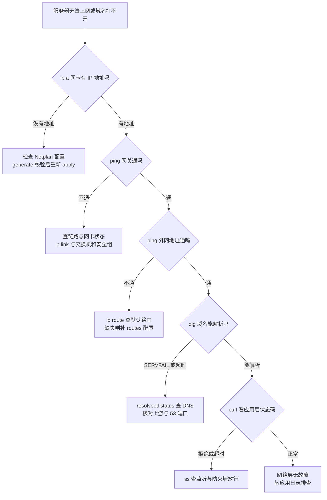

# 第 08 部分：故障排查与应急响应

服务器故障很少挑时间发生：它往往出现在业务高峰、深夜值班或版本发布之后。本部分按真实应急现场的处置顺序组织内容，帮助读者先让业务恢复，再把根因查清，最后把同类问题挡在下一次故障之前。

## 本部分地图

| 章节 | 文件 | 解决的问题 |
| --- | --- | --- |
| 8.1 | `01-boot-repair.md` | 系统无法启动时，如何从 GRUB、Rescue 模式、Live 介质与 chroot 一步步把系统救回来 |
| 8.2 | `02-network-diagnosis.md` | 网络不通、高延时与丢包时，如何按分层顺序定位故障点，而不是四处试命令 |
| 8.3 | `03-disk-full.md` | 磁盘空间爆满、文件句柄耗尽时，如何找到真正占满空间或句柄的对象 |
| 8.4 | `04-cpu-memory.md` | CPU 与内存异常飙高时，如何定位到具体进程、服务与代码行为 |
| 8.5 | `05-disaster-recovery-migration.md` | 整机迁移、密钥丢失、升级失败等灾难场景下，如何按 RTO/RPO 把系统与数据恢复回来并验证 |

## 每章一句话

- **8.1 系统无法启动故障修复**：启动链条任何一环断裂都先保数据，再修引导、修文件系统、修配置。
- **8.2 网络不通、高延时与丢包排查**：从物理链路到应用层逐层验证，一层确认无误再进入下一层。
- **8.3 磁盘空间爆满与文件句柄耗尽**：空间问题先分清是数据量、inode 还是已删除未释放文件，三者处置完全不同。
- **8.4 CPU 与内存异常飙高定位**：先用全局指标判断瓶颈类型，再下钻到进程、服务与系统调用证据。
- **8.5 灾难恢复与系统迁移**：先按 RTO/RPO 定恢复目标，再走迁移与恢复流程，每一步恢复后都要验证数据与服务真的可用。

## 应急总原则

**第一，先止血，后定位。** 业务中断时，优先恢复服务：回滚最近变更、切换备用节点、重启已确认无状态的服务、扩容临时资源。根因分析重要，但不能让业务为取证长时间停摆。

**第二，先保留现场证据，后动手修改。** 故障现场一旦被重启、清理或覆盖，很多证据永久消失。动手前至少保留四类信息：当前时间与故障现象、关键日志片段、正在运行的进程与资源快照、最近一次变更记录。可先执行下面的命令把基础现场留存下来：

```bash
INCIDENT_DIR=/var/tmp/incident-$(date +%Y%m%d-%H%M%S)
sudo mkdir -p "$INCIDENT_DIR"
sudo journalctl -b -0 --no-pager | sudo tee "$INCIDENT_DIR/journal.txt" > /dev/null
sudo dmesg -T | sudo tee "$INCIDENT_DIR/dmesg.txt" > /dev/null
ps auxf | sudo tee "$INCIDENT_DIR/ps.txt" > /dev/null
ss -tulnp | sudo tee "$INCIDENT_DIR/ss.txt" > /dev/null
df -hT | sudo tee "$INCIDENT_DIR/df.txt" > /dev/null
free -h | sudo tee "$INCIDENT_DIR/free.txt" > /dev/null
echo "$INCIDENT_DIR"
```

**第三，一次只改一个变量。** 同时改配置、重启服务、清理日志，会让事后复盘无法判断到底是哪一步起作用，也可能引入新故障。

**第四，修复必须验证，验证必须留记录。** 恢复的判据是业务指标与用户侧访问恢复正常，而不是命令退出码为零。把处置时间线、执行命令、观察结果写进故障记录，复盘时才有据可查。

**第五，高危操作先确认对象。** 涉及删除、写盘、检查文件系统、重写引导的操作，执行前再次核对设备名、挂载点与备份状态。

## 建议阅读顺序

首次阅读按 8.1 至 8.4 顺序通读。真实故障时按现象直达对应章节：开不了机看 8.1，连不上看 8.2，写不进磁盘看 8.3，机器卡顿看 8.4。处置完成后回到本页做收尾：补证据、补监控、补预案。

## 网络故障决策树（无法上网 / DNS 解析失败）

先按图自上而下定位故障层，再用下面 5 个命令逐项实证，不要跳步猜测。



### 5 个关键诊断命令逐行判读

1. `ip a` — 看网卡与地址。重点行：网卡状态应为 `state UP` 且带 `LOWER_UP`；`inet 192.0.2.10/24` 一行确认地址与掩码已生效；只有 `127.0.0.1` 说明业务网卡没拿到地址，先查 Netplan。
2. `ip route` — 看路由表。必须有一行 `default via 192.0.2.1 dev eth0`，没有默认路由就出不了本地网段；再核对直连网段行 `192.0.2.0/24 dev eth0` 的网卡名是否正确。
3. `resolvectl status` — 看 DNS 归属。重点行：业务网卡段落下的 `Current DNS Server` 与 `DNS Servers` 应是你配置的上游；若为空或指向错误地址，解析必然失败；`Protocols: -LLMNR -mDNS` 等开关行可确认没有多余协议干扰。
4. `ping -c 3 <目标>` — 分层测连通。先 ping 网关（通=本地链路与二层正常），再 ping 一个外网地址（通=路由与 NAT 正常），最后 ping 域名（前两步通而这步不通=纯 DNS 问题）；看 `packet loss` 与 `time` 两列判读丢包和时延。
5. `dig example.com` — 看解析细节。重点行：`status: NOERROR` 为正常，`SERVFAIL` 是上游或 DNSSEC 问题，`NXDOMAIN` 是域名不存在或记录没配；`ANSWER SECTION` 应有 A 记录；`Query time` 过大或超时说明 53 端口被拦或上游不可达；末尾 `SERVER: 192.0.2.53#53` 确认实际询问的是哪台 DNS。

完整命令集见 [网络问题系统化诊断](02-network-diagnosis.md)。
