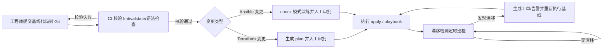

# IaC 与 GitOps 深化（Ansible / Terraform）

## 一、概述与使用场景

本章目标：**任意一台空白 Ubuntu 机器，能用一条流水线自动构建成符合标准的生产基线**——用户、SSH 加固、内核参数、基础软件、防火墙、时间同步全部到位，且可重复、可审计、可回滚。这就是基础设施即代码（IaC）：把「机器应该是什么样」写成代码，而非逐台手敲。

不用 IaC 的风险：手工机器必然漂移——这台忘关 root 登录、那台参数是旧的；无人说得清每台改过什么；扩容时逐台重复劳动且错误率上升。有了 IaC，基线只有一份代码，变更走 Git 评审，出问题能定位到具体提交。

工具分工：

- **Terraform**：负责「有没有这台机器」——创建/销毁云实例或本地虚拟机，管理资源生命周期。
- **Ansible**：负责「机器里是什么样」——系统配置、软件包、服务状态。
- **GitOps**：负责「变更怎么生效」——所有变更以 Git 为唯一事实来源，经 CI 校验后自动/半自动执行，并持续检测实际状态与代码的漂移。

与既有章节分工：[第 07 部分 Ansible 入门章](../07-automation/03-ansible.md) 讲安装、inventory、ad-hoc 与第一个 playbook；**本章不重复入门**，直接讲基线 role 工程化、Terraform 落地与 state 管理、GitOps 闭环。没读过入门章请先补完。

## 二、环境准备与前置条件

| 项目 | 要求 |
| --- | --- |
| 控制机 | Ubuntu 22.04/24.04 LTS（可为运维跳板机或 CI  runner） |
| 目标机 | Ubuntu 22.04/24.04 LTS，已开启 SSH，控制机可免密登录 |
| 权限 | 目标机上有一个可 `sudo` 的账号（示例用 `opsadmin`） |
| 软件 | Git、Ansible、Terraform（版本以各自官方文档为准） |
| 仓库 | 一个私有 Git 仓库存放基线代码（示例 remote 用 `git@github.com:example-org/ubuntu-baseline.git` 形态表示） |

安装与自检：

```bash
sudo apt update
sudo apt install -y git ansible
ansible --version
git --version
# Terraform 请按 HashiCorp 官方文档的 apt 仓库方式安装，装后自检：
terraform version
```

准备工作区：

```bash
mkdir -p ~/iac && cd ~/iac
git clone git@github.com:example-org/ubuntu-baseline.git
cd ubuntu-baseline
```

!!! note "控制机不要用生产业务机"
    Ansible/Terraform 的控制机持有通往所有目标机的 SSH 凭据与 state 文件，应放在受控的运维机或 CI 环境中，不要与业务服务混部。

## 三、手把手操作步骤

### 3.1 Ansible 基线工程化：role 目录结构

入门章的单文件 playbook 在机器变多后难以维护。基线工程化做法是拆成 role，每个 role 管一个领域：

```text
ubuntu-baseline/
├── ansible/
│   ├── inventory/
│   │   ├── hosts.yml
│   │   └── group_vars/
│   │       └── all.yml
│   ├── roles/
│   │   ├── users/          # 运维账号与 sudo 规则
│   │   │   ├── tasks/main.yml
│   │   │   └── templates/sudoers_ops.j2
│   │   ├── ssh_hardening/  # SSH 安全加固
│   │   │   ├── tasks/main.yml
│   │   │   ├── handlers/main.yml
│   │   │   └── templates/sshd_baseline.conf.j2
│   │   ├── sysctl_baseline/ # 内核参数基线
│   │   │   └── tasks/main.yml
│   │   └── packages/       # 基础软件包
│   │       └── tasks/main.yml
│   └── playbooks/
│       └── baseline.yml    # 基线总入口
└── terraform/
    └── （见 3.2 节）
```

入口 playbook `ansible/playbooks/baseline.yml` 完整内容：

```yaml
---
- name: 应用 Ubuntu 生产基线
  hosts: baseline
  become: true
  roles:
    - users
    - ssh_hardening
    - sysctl_baseline
    - packages
```

inventory `ansible/inventory/hosts.yml`（地址为文档示例段）：

```yaml
all:
  children:
    baseline:
      hosts:
        server-a.example.com:
          ansible_host: 192.0.2.10
        server-b.example.com:
          ansible_host: 192.0.2.11
      vars:
        ansible_user: opsadmin
```

### 3.2 基线 role 示例片段

**用户 role** `roles/users/tasks/main.yml`：

```yaml
---
- name: 创建运维账号 opsadmin
  ansible.builtin.user:
    name: opsadmin
    shell: /bin/bash
    groups: sudo
    append: true
    state: present

- name: 下发 opsadmin 的 sudoers 规则
  ansible.builtin.template:
    src: sudoers_ops.j2
    dest: /etc/sudoers.d/opsadmin
    mode: "0440"
    validate: "visudo -cf %s"
```

模板 `roles/users/templates/sudoers_ops.j2`：

```ini
opsadmin ALL=(ALL) NOPASSWD: /usr/bin/systemctl, /usr/bin/journalctl, /usr/bin/apt
```

说明：sudo 只放行常用命令而非 `ALL`；`validate` 保证语法错时不写坏 sudoers。

**SSH 加固 role** `roles/ssh_hardening/tasks/main.yml`：

```yaml
---
- name: 备份原 sshd_config（带时间戳，仅首次保留原版）
  ansible.builtin.copy:
    src: /etc/ssh/sshd_config
    dest: /etc/ssh/sshd_config.orig.bak
    remote_src: true
    force: false
    mode: "0600"

- name: 下发 SSH 基线配置片段
  ansible.builtin.template:
    src: sshd_baseline.conf.j2
    dest: /etc/ssh/sshd_config.d/90-baseline.conf
    mode: "0600"
  notify: 重启 ssh 服务

- name: 校验 sshd 配置语法
  ansible.builtin.command: sshd -t
  changed_when: false
```

模板 `roles/ssh_hardening/templates/sshd_baseline.conf.j2`：

```ini
PermitRootLogin no
PasswordAuthentication no
PubkeyAuthentication yes
MaxAuthTries 3
X11Forwarding no
```

handler `roles/ssh_hardening/handlers/main.yml`：

```yaml
---
- name: 重启 ssh 服务
  ansible.builtin.service:
    name: ssh
    state: restarted
```

!!! warning "改 SSH 前留好后路"
    下发 SSH 加固前，务必确认 `opsadmin` 的公钥登录已可用，并保持一个已登录的会话不要断开。先在一台测试机执行、验证新会话能登录后，再推广到全量。下发到 `sshd_config.d/` 片段而非覆盖主文件，也是为了出问题时删片段即可回滚。

**sysctl role** `roles/sysctl_baseline/tasks/main.yml`：

```yaml
---
- name: 下发内核参数基线
  ansible.builtin.copy:
    dest: /etc/sysctl.d/90-baseline.conf
    mode: "0644"
    content: |
      net.ipv4.ip_forward = 0
      net.ipv4.conf.all.accept_redirects = 0
      net.ipv4.conf.all.log_martians = 1
      kernel.dmesg_restrict = 1
      fs.file-max = 2097152
  notify: 重新加载 sysctl

- name: 立即应用 sysctl 基线
  ansible.builtin.command: sysctl --system
  changed_when: false
```

参数说明：关闭转发与重定向接受是普通服务器基线（网关/容器宿主机需调整 `ip_forward`）；`log_martians` 记录异常源包便于审计；`dmesg_restrict` 限制普通用户读内核日志；`file-max` 抬高句柄上限支撑高并发。

**包管理 role** `roles/packages/tasks/main.yml`：

```yaml
---
- name: 更新 apt 缓存（24 小时内不重复更新）
  ansible.builtin.apt:
    update_cache: true
    cache_valid_time: 86400

- name: 安装基线软件包
  ansible.builtin.apt:
    name:
      - curl
      - vim
      - htop
      - ufw
      - unattended-upgrades
      - chrony
    state: present

- name: 确保时间同步服务运行
  ansible.builtin.service:
    name: chrony
    state: started
    enabled: true
```

执行基线（先检查模式，再正式执行）：

```bash
cd ~/iac/ubuntu-baseline/ansible
# 只演练不改动：--check 输出将变更项
ansible-playbook -i inventory/hosts.yml playbooks/baseline.yml --check --diff
# 确认无误后正式执行
ansible-playbook -i inventory/hosts.yml playbooks/baseline.yml
```

### 3.3 Terraform 入门深化

**核心概念**：provider 是与目标平台对话的插件（云厂商、`libvirt` 等）；resource 是要管理的对象（实例、磁盘、网络）；state 记录「代码与真实资源对应关系」，是更新与漂移对比的依据。

**本地 libvirt 示例**（在装有 KVM/libvirt 的 Ubuntu 宿主机上创建一台 Ubuntu 虚拟机，片段）：

```hcl
terraform {
  required_providers {
    libvirt = {
      source  = "dmacvicar/libvirt"
      version = "~> 0.8"
    }
  }
}

provider "libvirt" {
  uri = "qemu:///system"
}

resource "libvirt_domain" "ubuntu_node" {
  name   = "ubuntu-baseline-01"
  memory = 4096
  vcpu   = 2
}
```

**云上创建 Ubuntu 实例的通用片段**（资源类型名以厂商 provider 文档为准）：

```hcl
variable "region" {
  type    = string
  default = "example-region-1"
}

variable "admin_password" {
  type      = string
  sensitive = true
}

resource "examplecloud_instance" "ubuntu_node" {
  name            = "ubuntu-baseline-01"
  region          = var.region
  image           = "ubuntu-24.04"
  size            = "2vcpu-4gb"
  ssh_keys        = ["opsadmin-key"]
  admin_password  = var.admin_password
}

output "instance_ip" {
  value = examplecloud_instance.ubuntu_node.ipv4_address
}
```

工作流命令：

```bash
cd ~/iac/ubuntu-baseline/terraform
cp terraform.tfstate terraform.tfstate.bak.$(date +%F) 2>/dev/null || echo "尚无 state，跳过备份"
terraform init      # 下载 provider，初始化工作目录
terraform fmt       # 格式化代码
terraform validate  # 语法与配置校验
terraform plan      # 预览将创建/修改/销毁什么，不实际执行
terraform apply     # 人工确认 plan 输出后执行
```

**state 管理与敏感变量**：

- state 含资源 ID、IP、甚至明文敏感值，**等同敏感数据**：本地权限设 `600`，团队协作改用带加密与锁的远程后端（配置以云厂商文档为准）。
- 敏感变量声明 `sensitive = true` 后不会在 plan/apply 输出中回显；真实值通过环境变量注入，不写进代码文件：

```bash
export TF_VAR_admin_password="<api-key>"
terraform plan
```

- `.gitignore` 必须排除 `*.tfstate`、`*.tfstate.*`、`.terraform/`、`*.tfvars`（含真实值的变量文件），提交前用 `git status` 复查。

!!! warning "terraform apply 前必看 plan"
    `plan` 输出中的 `destroy` 项意味着资源将被销毁重建。没有逐行看完 plan 就直接 apply，是 Terraform 使用中最常见的事故来源；生产环境应把 apply 设置为人工审批后执行（见 3.4 节流水线）。

### 3.4 GitOps 流程：从提交到闭环



流程说明：Git 是唯一事实来源，绕过仓库直接改机会在漂移检测环节暴露；CI 挡住语法与格式问题；`apply` 前保留人工审批；结果回写工单/告警系统形成闭环。CI 要点：把 `terraform fmt -check`、`terraform validate`、`ansible-playbook --syntax-check` 作为合并前必过项。

### 3.5 漂移检测与合规巡检思路

- **Terraform 侧**：定时（如每日凌晨）在 CI 或巡检机执行 `terraform plan -detailed-exitcode`：退出码 0 表示无漂移，2 表示存在差异，任务据此告警。
- **Ansible 侧**：定时以 `--check --diff` 模式跑基线 playbook，输出中出现 `changed` 即说明目标机实际状态与基线不一致，收集汇总成巡检报告。
- **合规巡检清单化**：把安全要求写成可检查项——SSH 是否禁 root、UFW 是否开启、自动升级是否启用、sysctl 值是否被改——逐项比对并留档。
- **漂移处理原则**：先查原因（临时改机忘回滚，还是基线需更新），该回滚的走流水线重下发，该更新的改代码走评审；**不要**在巡检时「顺手修复」，那会制造新的不可审计变更。巡检脚本只需以 `--check --diff` 模式定时跑基线 playbook 并汇总日志中的 `changed` 项即可，只检测、不修改。

## 四、效果验证与测试

```bash
# 1. 目标机 SSH 基线验证：应输出 no
ssh opsadmin@192.0.2.10 "sudo sshd -T | grep -i permitrootlogin"
# 期望：permitrootlogin no

# 2. sysctl 基线验证
ssh opsadmin@192.0.2.10 "sysctl net.ipv4.conf.all.log_martians kernel.dmesg_restrict"
# 期望：两个值均为 1

# 3. Terraform 无漂移验证：退出码应为 0
cd ~/iac/ubuntu-baseline/terraform
terraform plan -detailed-exitcode -no-color
echo "退出码：$?"

# 4. Ansible 幂等验证：第二次执行应几乎全为 ok、无 changed
cd ~/iac/ubuntu-baseline/ansible
ansible-playbook -i inventory/hosts.yml playbooks/baseline.yml
```

期望输出示例（节选）：

```text
PLAY RECAP *********************************************************************
server-a.example.com : ok=12   changed=0    unreachable=0    failed=0
server-b.example.com : ok=12   changed=0    unreachable=0    failed=0
```

`changed=0` 且 `failed=0` 说明基线已收敛、playbook 具备幂等性，这是基线合格的核心标志。

## 五、常见错误与排坑指南

**场景 1：Terraform 执行时报 state 被锁定**

```text
Error: Error acquiring the state lock
Error message: state blob is already locked
```

原因：上一次 apply 被中断，或另一个进程正在操作同一 state。修复：先确认确实无人正在执行 Terraform，再按报错输出给出的信息解锁；使用远程后端时优先排查并发执行，不要养成随手强制解锁的习惯：

```bash
terraform force-unlock <lock-id>
terraform plan
```

**场景 2：Ansible 执行 SSH 加固后新会话无法登录**

```text
opsadmin@192.0.2.10: Permission denied (publickey).
```

原因：关闭密码登录后才发现公钥未正确下发，或 `sshd_config.d` 片段优先级导致预期外的配置生效。修复：用尚存的已登录会话（3.2 节强调保留的原因）或云厂商控制台登录目标机，检查 `~/.ssh/authorized_keys` 权限（应为 `600`、家目录不大于 `755`），用 `sudo sshd -T` 查看实际生效配置，必要时删除 `/etc/ssh/sshd_config.d/90-baseline.conf` 并重启 ssh 回滚加固片段。

**场景 3：playbook 重复执行每次都报 changed（不幂等）**

```text
TASK [sysctl_baseline : 立即应用 sysctl 基线] *** changed: [server-a.example.com]
```

原因：用了 `command`/`shell` 模块执行本可由专用模块管理的动作，这类模块默认每次都报告 changed。修复：优先改用幂等模块（如 `ansible.builtin.sysctl`、`apt`、`template`）；确实只能用命令时，加 `changed_when: false` 明确声明其只读/应用性质，并保证动作本身重复执行无副作用。

## 六、生产环境最佳实践与安全建议

- **变更全走 Git**：基线经提交、评审、合并进入主干；禁止绕过仓库改生产机，紧急修复也要事后补提交。
- **审批卡点不可省**：CI 自动校验可以全自动，但 `terraform apply` 与 Ansible 正式执行在生产环境保留人工审批；审批人要看的是 plan/diff 输出，不是只点同意。
- **凭据与 state 当机密管**：私钥、云凭据用密钥管理或 CI 受保护变量注入；state 用加密远程后端加锁，本地副本 `600` 且不进 Git。
- **先灰度后全量**：变更先在金丝雀机执行观察，再分批推广；playbook 用 `--limit` 控制范围。
- **回滚预先演练**：每类变更都要有回滚方式（删配置片段、切回上一 Git 提交重执行、Terraform 回退上一版本 apply），测试环境演练过再上生产。
- **巡检常态化**：漂移与合规巡检定时运行、结果进告警工单；每月复盘漂移原因，反向优化基线。
